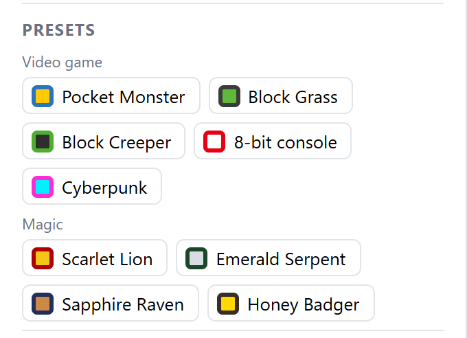
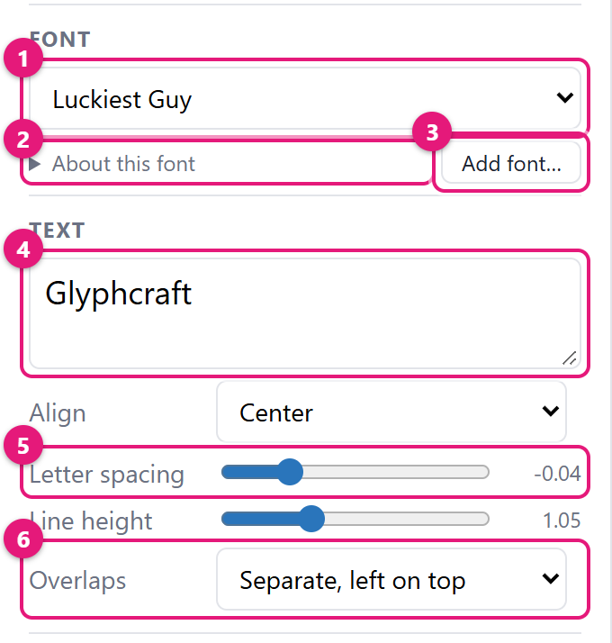
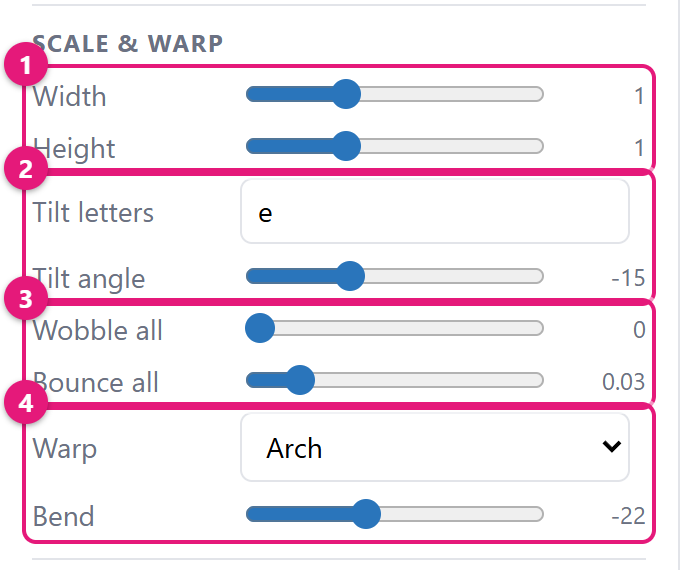
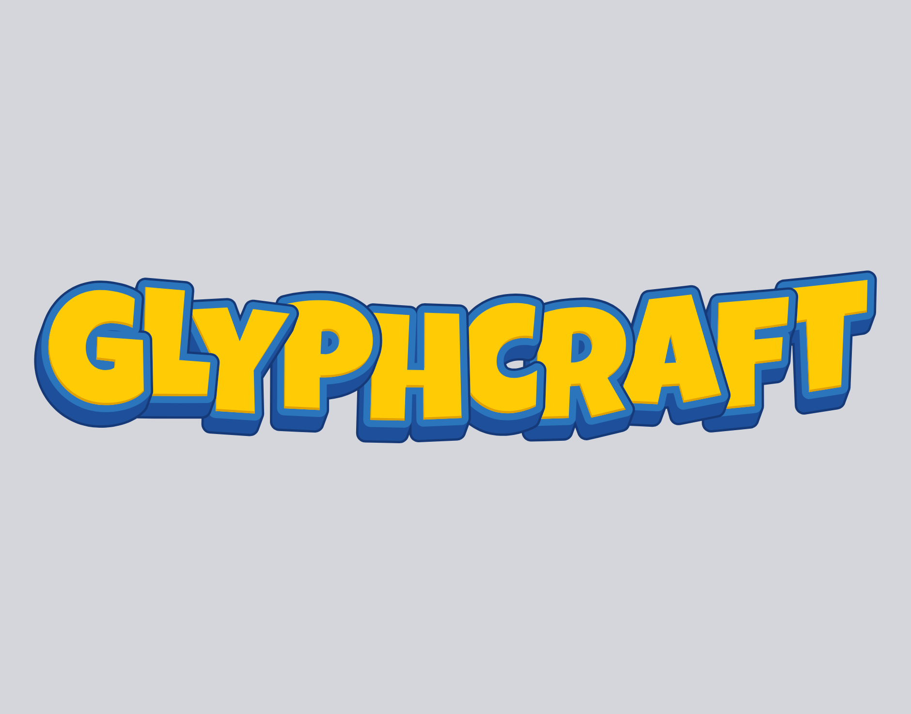
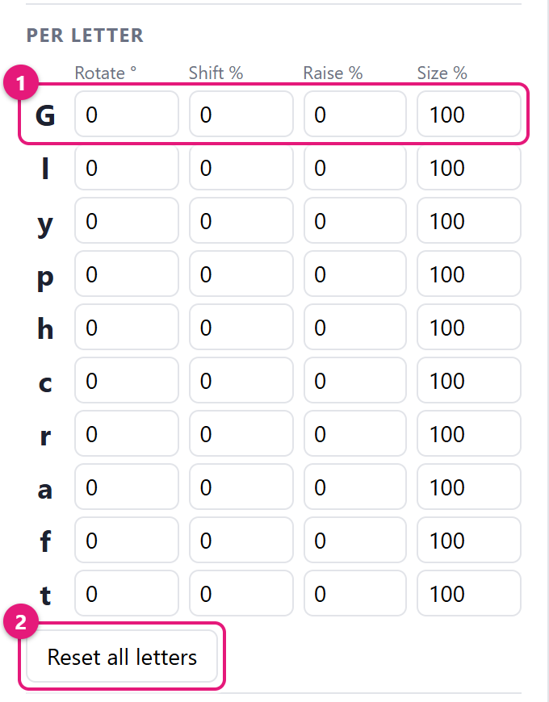
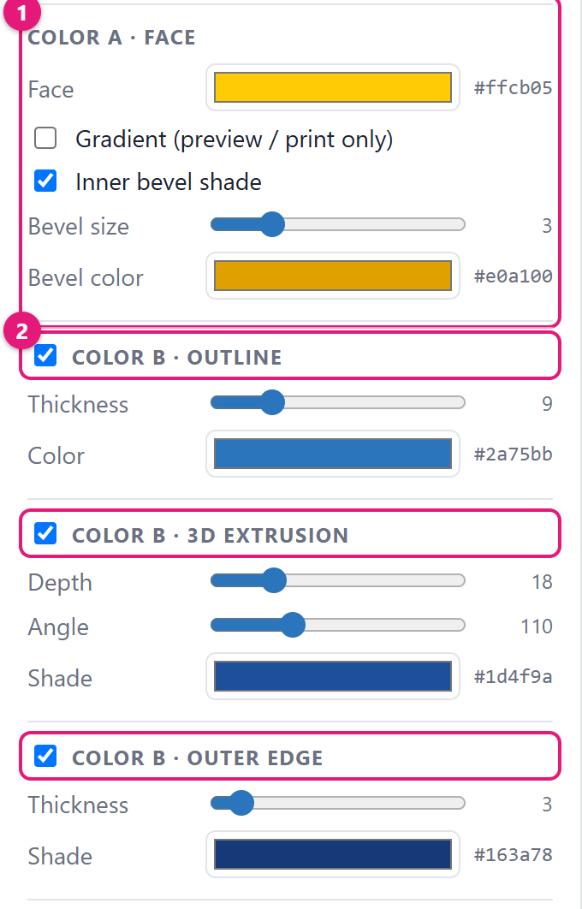
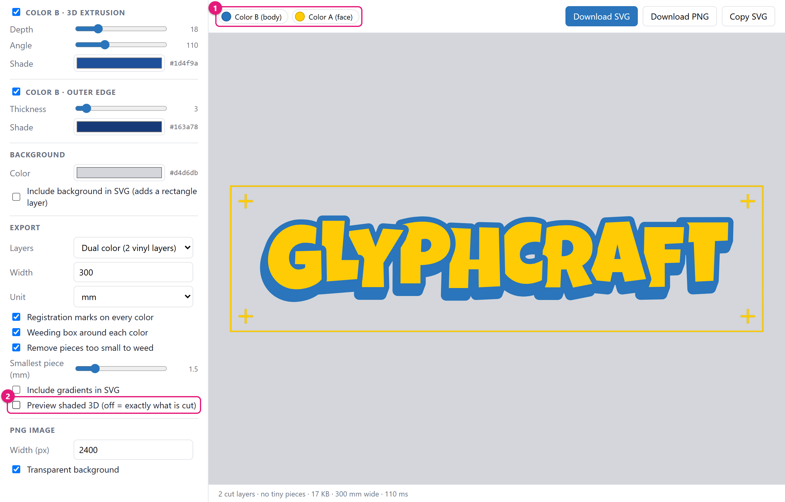
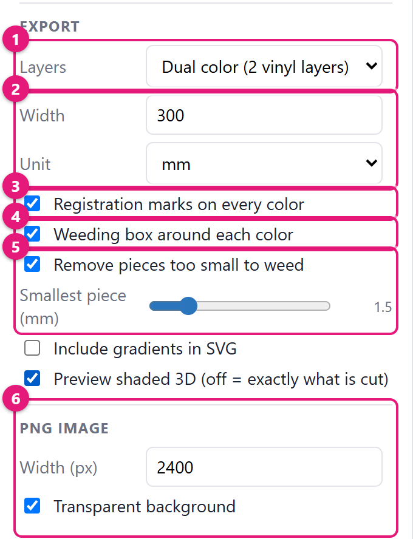

# Using Glyphcraft

A walkthrough of the app, from picking a style to downloading a file you can cut. Try it at **[footgunz.github.io/glyphcraft](https://footgunz.github.io/glyphcraft/)**.

Once your SVG is ready, see [Cutting with Cricut Design Space](cricut.md).


1. **Controls**: everything you can change, top to bottom in the order this guide follows.
2. **Preview**: updates live as you change settings.
3. **Layer chips**: show or hide each vinyl color in the preview.
4. **Download SVG / Download PNG / Copy SVG**.
5. **Status bar**: how many layers will be cut, tiny pieces removed, file size and physical width.

Settings are remembered in your browser between visits.

## 1. Pick a preset



**Presets** set the colors, layer sizes, spacing and letter play in one click, and switch to a matching font: each preset lists fonts in order of preference and uses the first one installed, so it picks a personal-use font when you have it and an open-licensed one otherwise. They keep your text, background and export settings.

| Group | Presets |
| --- | --- |
| Video game | Pocket Monster, Block Grass, Block Creeper, 8-bit console, Cyberpunk |
| Magic | Scarlet Lion, Emerald Serpent, Sapphire Raven, Honey Badger |

## 2. Text and font



1. **Font**: grouped into *Your fonts (personal use)* and *Open-licensed (OK to share)*.
2. **About this font** shows the copyright, designer and license details stored in the font, plus its bundled license file.
3. **Add font…** loads a `.ttf`, `.otf` or `.woff` for this session.
4. **Text**: multiple lines are fine. Mixing upper and lower case can add a playful look.
5. **Letter spacing**: negative values make letters overlap.
6. **Overlaps**: when letters overlap, *Separate* keeps each letter's own outline so they read like stacked stickers (choose whether left or right letters sit on top); *Merge* blends touching letters into one shape.

## 3. Shape it



1. **Width / Height** stretch the whole text.
2. **Tilt letters / Tilt angle**: rotate specific letters. `e` also matches é, è, ê and ë.
3. **Wobble all / Bounce all**: alternate rotation and baseline up and down across letters for a playful feel.
4. **Warp**: Arc, Arch, Arc upper/lower, Bulge, Fisheye, Wave, Rise or Perspective, with a **Bend** amount. A negative Bulge pinches the middle so the end letters come out biggest.

Here is the same text with an Arch warp:



### Per letter



1. One row per letter to **Rotate**, **Shift** left/right, **Raise** and **Size** it by hand.
2. Rows follow letter position, so editing earlier text shifts them; use **Reset all letters** if that happens.

Double-click any slider to reset it.

## 4. Style the layers



Each design is built from these layers, bottom to top:

| Layer | Vinyl color | What it is |
| --- | --- | --- |
| Outer edge | B | A thin outline around everything |
| 3D extrusion | B | The face and outline swept along an angle for depth |
| Outline | B | A thick border around each letter |
| Face | A | The letters themselves |
| Inner bevel shade | A | A darker sliver along the edges facing the extrusion |

1. **Color A · Face** sets the face color, an optional gradient (shown in the preview and PNG; cutters ignore it) and the inner bevel shade.
2. Each **Color B** layer has a checkbox in its heading to turn it off.

## 5. Check what will be cut



1. Click the **Color A / Color B** chips above the preview to hide or show a layer in place.
2. Turn off **Preview shaded 3D** to see exactly what goes into the SVG, including registration marks and the weeding box.

**Background** sets the preview color, and can optionally be added to the SVG as a rectangle layer.

## 6. Export



**Download SVG** or **Copy SVG** for cutting.

1. **Layers** chooses how colors are split:

   | Layers mode | Output |
   | --- | --- |
   | **Dual color** (default) | Two layers: **Color B** is the outline, extrusion and outer edge merged into one body; **Color A** is the face. Apply A on top of B. |
   | Every layer, stacked | Each layer as its own full shape, meant to be stacked. |
   | Every layer, knocked out | Each layer with everything above it cut away, so nothing overlaps. |

2. **Width** and **Unit** set the physical size (mm, inches or px) of the whole file, marks and box included.
3. **Registration marks**: identical crosshairs at the corners of every color layer. Line them up when stacking colors, then peel them off.
4. **Weeding box**: a thin frame around each color to make weeding easier.
5. **Remove pieces too small to weed**: drops pieces and holes smaller across than **Smallest piece (mm)**. In the cut preview, removed pieces show in red and the status bar counts them.
6. **PNG image**: **Download PNG** renders what the preview shows at this **Width (px)**, with a transparent background unless you turn that off.

The three cutting helpers are on by default.

## Updating these screenshots

The images in [`assets/`](assets/) are generated from the public build (open-licensed fonts only). After changing the UI, regenerate them with:

```bash
npm run docs:screenshots
```

It uses an installed Chrome or Edge; set `CHROME_PATH` to pick a specific browser.
